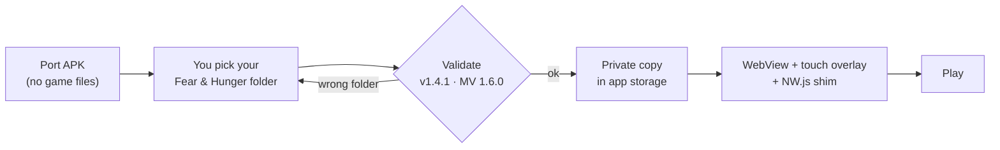
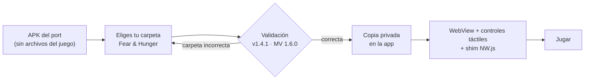

<p align="center">
  
</p>

<p align="center">
  <a href="https://github.com/Michu117/fear-decomp/releases/latest"></a>
  
  
  
  
  <a href="LICENSE"></a>
</p>

<h3 align="center">
  <a href="#english">English</a>
  &nbsp;&nbsp;·&nbsp;&nbsp;
  <a href="#espanol">Español</a>
</h3>

<table align="center">
  <tr>
    <td align="center" width="33%">
      <b>Bring your own copy</b><br>
      <sub>The APK carries no game data — you point it at <i>your</i> PC copy.</sub><br>
      <sub><i>Trae tu copia: el APK no lleva nada del juego.</i></sub>
    </td>
    <td align="center" width="33%">
      <b>Made for touch</b><br>
      <sub>D-pad or joystick, torch &amp; Shift buttons, all movable and resizable.</sub><br>
      <sub><i>Controles táctiles a tu medida.</i></sub>
    </td>
    <td align="center" width="33%">
      <b>Tuned for phones</b><br>
      <sub>Fog &amp; light filters at half resolution, 30/60 FPS cap.</sub><br>
      <sub><i>Optimizado para móviles.</i></sub>
    </td>
  </tr>
</table>

<p align="center">
  
</p>

---

<a id="english"></a>

## English

Play **Fear & Hunger** on your Android phone or tablet using **your own copy** of the PC
game. The app is tiny, works fully offline and never redistributes a single byte of the game:
on first launch it asks for your game folder and builds a private, on-device copy.

### Quick start

| | Step |
|:-:|---|
| **1** | Download **`fh-android-port-v1.1.0.apk`** from [Releases](https://github.com/Michu117/fear-decomp/releases/latest) and install it (allow *install unknown apps* if asked). |
| **2** | Copy your PC game folder **`Fear & Hunger`** (the one with `package.json` and `www/`) to the phone, e.g. into `Download/`. |
| **3** | Open the app → **Select game folder** → pick that folder. It validates and extracts it once (~1 GB, a few minutes). |
| **4** | Play. Next launches go straight into the game. |

### How it works



Your original folder is **never modified**. PC saves found in it are imported once.

### Features

| | |
|---|---|
| **Touch controls** | D-pad **or joystick** · **A** confirm · **B** cancel · **≡** menu · **torch** (PC `T`) · **Shift** (hold while interacting: backstab, bow and other special actions) |
| ⚙ **Settings menu** | FPS cap 30/60 · live FPS counter · show/hide torch & Shift · arrows ↔ joystick · opacity · vibration |
| **Your layout** | *Reposition / size*: drag any control; tap it and use **− / +** (or pinch) to resize it from 60 to 180 % — everything is saved |
| **Languages** | App UI in **English** (default) and **Spanish** — follows the phone, or pick it in ⚙ → *Language*. The game text is untouched |
| **Performance** | Half-resolution light/fog filters (the fog lags even on PC) · 30 FPS by default, 60 one tap away |
| **Private** | No internet permission · no account · no telemetry · saves live only on your device |

### Requirements

- Android **8.0+** (64-bit).
- **Your own legitimate copy** of Fear & Hunger for PC — game **v1.4.1** (Steam or any source you own).
- **~1 GB** free storage.

<details>
<summary><b>Build from source</b></summary>

```bash
cd android
gradle assembleRelease      # JDK 21 + Android SDK  → app/build/outputs/apk/release/app-release.apk
gradle assembleDebug        # development build     → app/build/outputs/apk/debug/app-debug.apk
```

| Build | Logs (`FH-PORT`, JS console) | WebView remote debugging | Use |
|---|---|---|---|
| `release` | off | off | the APK published in Releases |
| `debug` | on | on (`chrome://inspect`) | development and testing |

Both are signed with the local Android debug key, so a newer release installs over an
older one without losing saves. To publish under your own identity, create a keystore and
point the `release` `signingConfig` to it.

| Piece | File |
|---|---|
| Setup screen (folder picker, validation, extraction) | `android/app/src/main/java/com/fhport/app/MainActivity.java` |
| Game host (WebView, local asset server, saves import) | `android/app/src/main/java/com/fhport/app/GameActivity.java` |
| NW.js → browser shim | `android/app/src/main/assets/shim-nw.js` |
| Audio / performance compat | `android/app/src/main/assets/android-compat.js` |
| Touch overlay + ⚙ menu (+ translations) | `android/app/src/main/assets/android-touch.js` |
| Native UI translations | `android/app/src/main/res/values*/strings.xml` | **Adding a language:** add a dictionary to `I18N` in `android-touch.js` and a
`res/values-xx/strings.xml`. It shows up in ⚙ → *Language* automatically.

</details>

<details>
<summary><b>Troubleshooting</b></summary>

- **The folder is rejected** — pick the folder that directly contains `package.json`;
  `www/data/System.json` must have `versionId` `14145329` (game v1.4.1 / MV 1.6.0).
- **Black screen** — force-close and relaunch. Runtime scripts refresh on every start, so app
  updates never require picking the folder again.
- **Logs for a bug report** — the published APK writes no logs. Build and install the
  `debug` variant, then use `adb logcat -s FH-PORT:V` (port) and
  `adb logcat -d | grep chromium` (in-page console).

</details>

<details>
<summary><b>Known harmless quirks</b></summary>

- `SyntaxError: Unexpected identifier 'Object'` in the console comes from a dead plugin bundled
  with the game — same on PC.
- `Steamworks failed to initialize` — expected outside Steam; Steam integration is stubbed.
- TerraxLighting PIXI deprecation warnings — cosmetic.

</details>

<details>
<summary><b>Uninstall</b></summary>

Uninstall the app. Everything (saves included) lives in its private storage; your game folder
stays untouched.

</details>

> [!IMPORTANT]
> This repository and its APK contain **no game files, no game assets and no decompiled game
> code**. All game data comes from the copy **you** provide, stays on your device and is never
> redistributed. You must own the game —
> [buy Fear & Hunger on Steam](https://store.steampowered.com/app/865600/Fear__Hunger/).
> This project is not affiliated with or endorsed by the developer.

### Credits

- **Fear & Hunger** — Miro Haverinen · [Steam](https://store.steampowered.com/app/865600/Fear__Hunger/)
- RPG Maker MV 1.6.0 runtime — read from the player's own copy, never redistributed.
- [YEP_ButtonCommonEvents](https://yanflychannel.wordpress.com/) (Yanfly) — public plugin used by
  the game; referenced for the torch key mapping.
- Icon, banner and controls diagram — original SVG art (no game assets).
- **AI disclosure** — built with AI coding agents ([OpenCode](https://opencode.ai) with MiMo, and
  [Claude Code](https://claude.com/claude-code)), directed, tested on a real device and approved
  by a human.

**License:** port code under [MIT](LICENSE). The game is not included and remains property of its
developer.

<p align="right"><a href="#english">↑ top</a> · <a href="#espanol">Español ↓</a></p>

---

<a id="espanol"></a>

## Español

Juega **Fear & Hunger** en tu teléfono o tablet Android usando **tu propia copia** del juego de
PC. La app es diminuta, funciona sin internet y nunca redistribuye ni un byte del juego: en el
primer arranque te pide la carpeta del juego y crea una copia privada en el dispositivo.

### Inicio rápido

| | Paso |
|:-:|---|
| **1** | Descarga **`fh-android-port-v1.1.0.apk`** desde [Releases](https://github.com/Michu117/fear-decomp/releases/latest) e instálalo (permite *instalar apps desconocidas* si lo pide). |
| **2** | Copia al teléfono la carpeta del juego de PC **`Fear & Hunger`** (la que tiene `package.json` y `www/`), por ejemplo en `Download/`. |
| **3** | Abre la app → **Seleccionar carpeta del juego** → elige esa carpeta. La valida y la extrae una sola vez (~1 GB, unos minutos). |
| **4** | A jugar. Los siguientes arranques entran directo al juego. |

### Cómo funciona



Tu carpeta original **nunca se modifica**. Las partidas de PC que contenga se importan una vez.

### Funciones

| | |
|---|---|
| **Controles táctiles** | D-pad **o joystick** · **A** confirmar · **B** cancelar · **≡** menú · **antorcha** (`T` del PC) · **Shift** (mantener al interactuar: puñalada por la espalda, arco y otras acciones especiales) |
| ⚙ **Menú de ajustes** | Límite 30/60 FPS · contador de FPS · mostrar/ocultar antorcha y Shift · flechas ↔ joystick · opacidad · vibración |
| **Tu distribución** | *Reposicionar / tamaño*: arrastra cualquier control; tócalo y usa **− / +** (o pellízcalo) para cambiar su tamaño del 60 al 180 % — todo se guarda |
| **Idiomas** | Interfaz de la app en **inglés** (por defecto) y **español** — sigue al teléfono o elígelo en ⚙ → *Idioma*. El texto del juego no cambia |
| **Rendimiento** | Filtros de luz y niebla a media resolución (la niebla da lag incluso en PC) · 30 FPS por defecto, 60 a un toque |
| **Privado** | Sin permiso de internet · sin cuenta · sin telemetría · las partidas solo viven en tu dispositivo |

### Requisitos

- Android **8.0+** (64 bits).
- **Tu propia copia legítima** de Fear & Hunger para PC — versión **v1.4.1** (Steam u otra fuente de la que seas dueño).
- **~1 GB** de espacio libre.

<details>
<summary><b>Compilar desde el código</b></summary>

```bash
cd android
gradle assembleRelease      # JDK 21 + Android SDK  → app/build/outputs/apk/release/app-release.apk
gradle assembleDebug        # versión de desarrollo → app/build/outputs/apk/debug/app-debug.apk
```

| Variante | Logs (`FH-PORT`, consola JS) | Depuración remota del WebView | Uso |
|---|---|---|---|
| `release` | no | no | el APK publicado en Releases |
| `debug` | sí | sí (`chrome://inspect`) | desarrollo y pruebas |

Ambas se firman con la clave debug local de Android, así una versión nueva se instala
encima de la anterior sin perder partidas. Para publicar con tu propia identidad, crea un
keystore y apunta el `signingConfig` de `release` a él.

| Pieza | Archivo |
|---|---|
| Pantalla inicial (selector, validación, extracción) | `android/app/src/main/java/com/fhport/app/MainActivity.java` |
| Anfitrión del juego (WebView, servidor local, importación de partidas) | `android/app/src/main/java/com/fhport/app/GameActivity.java` |
| Shim NW.js → navegador | `android/app/src/main/assets/shim-nw.js` |
| Compatibilidad de audio / rendimiento | `android/app/src/main/assets/android-compat.js` |
| Controles táctiles + menú ⚙ (+ traducciones) | `android/app/src/main/assets/android-touch.js` |
| Traducciones de la UI nativa | `android/app/src/main/res/values*/strings.xml` | **Añadir un idioma:** agrega un diccionario a `I18N` en `android-touch.js` y un
`res/values-xx/strings.xml`. Aparece solo en ⚙ → *Idioma*.

</details>

<details>
<summary><b>Solución de problemas</b></summary>

- **Rechaza la carpeta** — elige la carpeta que contiene directamente `package.json`;
  `www/data/System.json` debe tener `versionId` `14145329` (juego v1.4.1 / MV 1.6.0).
- **Pantalla negra** — fuerza el cierre y vuelve a abrir. Los scripts se refrescan en cada
  arranque, así que actualizar la app nunca obliga a elegir la carpeta otra vez.
- **Logs para reportar un fallo** — el APK publicado no escribe logs. Compila e instala
  la variante `debug` y usa `adb logcat -s FH-PORT:V` (port) y
  `adb logcat -d | grep chromium` (consola de la página).

</details>

<details>
<summary><b>Peculiaridades conocidas (inofensivas)</b></summary>

- `SyntaxError: Unexpected identifier 'Object'` en la consola viene de un plugin muerto que
  trae el juego — igual que en PC.
- `Steamworks failed to initialize` — esperado fuera de Steam; la integración está anulada.
- Avisos de deprecación PIXI de TerraxLighting — solo cosméticos.

</details>

<details>
<summary><b>Desinstalar</b></summary>

Desinstala la app. Todo (partidas incluidas) vive en su almacenamiento privado; tu carpeta del
juego queda intacta.

</details>

> [!IMPORTANT]
> Este repositorio y su APK **no contienen archivos del juego, assets del juego ni código
> decompilado del juego**. Todos los datos vienen de la copia que **tú** proporcionas, se quedan
> en tu dispositivo y nunca se redistribuyen. Debes ser dueño del juego —
> [compra Fear & Hunger en Steam](https://store.steampowered.com/app/865600/Fear__Hunger/).
> Este proyecto no está afiliado ni respaldado por el desarrollador.

### Créditos

- **Fear & Hunger** — Miro Haverinen · [Steam](https://store.steampowered.com/app/865600/Fear__Hunger/)
- Runtime de RPG Maker MV 1.6.0 — se lee de la copia del jugador, nunca se redistribuye.
- [YEP_ButtonCommonEvents](https://yanflychannel.wordpress.com/) (Yanfly) — plugin público que usa
  el juego; referencia para el mapeo de la tecla de antorcha.
- Icono, banner y diagrama de controles — arte SVG original (sin assets del juego).
- **Transparencia de IA** — construido con agentes de programación con IA
  ([OpenCode](https://opencode.ai) con MiMo, y [Claude Code](https://claude.com/claude-code)),
  dirigido, probado en un dispositivo real y aprobado por una persona.

**Licencia:** código del port bajo [MIT](LICENSE). El juego no está incluido y sigue siendo
propiedad de su desarrollador.

<p align="right"><a href="#espanol">↑ arriba</a> · <a href="#english">English ↑</a></p>
